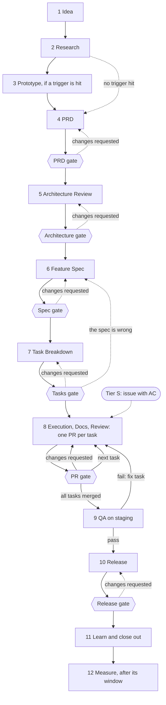

# SDLC Pipeline (12 phases, 6 human gates, 3 tiers)

**When to read:** before starting any feature, change, or investigation larger than a trivial fix.

The pipeline exists to learn that we are wrong **as early and as cheaply as possible**: the earlier an error is found, the cheaper it is to fix (a sentence in a PRD, then a paragraph in a spec, then code). Facts come before commitment: research and, when needed, a prototype feed the PRD, and architecture is judged against requirements that are already clear. Each phase writes a file in `specs/<feature-slug>/` so later phases and later sessions read the artifact, not the chat history. Agents MUST NOT start a phase before the gate of the previous phase is passed. Exception: in tier M the PRD, the feature spec, and the task breakdown are drafted together and approved together at the Spec gate.

## 1. Choose the tier first

Weight follows **size and risk**. State the tier in the `Tier:` line of `01-idea.md` and its triggers in section 1 (or in the issue for tier S). A human confirms it before work starts. Highest tier wins.

| Tier | When | Phases run |
|---|---|---|
| **S** | Bug fix with an obvious test, copy or small UI tweak, dependency patch bump with green CI, a refactor inside one feature that changes no behavior (skill `refactor`), a small config change (never a gate file; a new env var also goes in `.env.example` and the secret stores). **No trigger below.** | Issue with acceptance criteria (`templates/issue.md`) → 8 (one PR) → 9 (relevant tests, light) → 10 (normal deploy). 11 only if the agent was corrected. |
| **M** | New behavior inside **one** feature, or any S-sized change that hits a risk trigger. | 1 (short) → 2 if there are unknowns → 3 if a prototype trigger is hit → 4 (short) → 6 (short) → 7 → **Spec gate** (covers 4, 6, and 7) → 8 → 9 → 10 → 11 (brief) → 12 |
| **L** | Any L trigger below. | All phases except 3 when no prototype trigger is hit. Each gate separately, ADRs, rehearsed rollback. |

**Risk triggers** (any one raises S to at least M, with a human reviewing that risk area): auth, permissions, sessions; personal or payment data; a migration or backfill; a new dependency; a change to a contract other code relies on; a performance-sensitive path; an operation that cannot be undone.

**L triggers** (any one makes it L): a schema change to existing data; a change to the auth or permission model; a new external integration; a new cross-feature dependency or public API; an irreversible operation.

## 2. Phases

| # | Phase | Output (`specs/<slug>/`) | Driver | Gate |
|---|---|---|---|---|
| 1 | Idea | `01-idea.md` from `templates/idea.md`: the **problem** (not the solution), who has it and the evidence, short discovery notes, tier and triggers, the decision to go on | Human + agent | |
| 2 | Research | `02-research.md` from `templates/research.md`: unknowns answered with sources, library table with versions, options with evidence, the prototype triggers answered, tier re-check, what the PRD must take into account | Agent | |
| 3 | Prototype | `03-prototype.md` from `templates/prototype.md`, only when a prototype trigger in research section 5 is hit: a throwaway `spike/<slug>` branch, the result with evidence, and for UI the flow and layout a product owner has seen | Agent + human | |
| 4 | PRD | `04-prd.md` from `templates/prd.md` (skill `write-prd`): stories, functional and non-functional requirements, permissions and data, edge cases, success metric with baseline, target, window and owner, release and rollback expectations, **acceptance criteria as Given/When/Then** | Agent | **PRD gate** |
| 5 | Architecture Review | `05-architecture-review.md` from `templates/architecture-review.md`, tier L: ownership and boundary, public API, cross-feature calls and events, data impact, security, ADRs | Agent | **Architecture gate** |
| 6 | Feature Spec | `06-feature-spec.md` from `templates/feature-spec.md`: layer breakdown (files per layer), data model with indexes, contracts, schemas, errors, queries and cache, test strategy mapped to the acceptance criteria, rollout and rollback plan | Agent | **Spec gate** |
| 7 | Task Breakdown | `07-tasks.md` from `templates/tasks.md`: vertical tasks, one PR each, **riskiest first**, with a coverage check against the PRD and the spec | Agent | **Tasks gate** (tier M: in the Spec gate) |
| 8 | Execution, Docs, and Review, loop per task | Code, tests, and docs in one PR per task (see section 3), plus one entry per review round in `08-review-log.md` from `templates/review-log.md` (tier S: the PR is the record) | Agent + human | **PR gate** (every task) |
| 9 | QA | `09-qa.md` from `templates/qa.md`: result per acceptance criterion and edge case on staging, permission matrix, regression journeys, accessibility, performance against the NFRs, race conditions from the spec's collision points against a real database, zero deprecation warnings, defects with severity, and the result the Release gate reads. Tier S: the PR carries the evidence, no file | Agent + human | |
| 10 | Release | `10-release.md` from `templates/release-checklist.md` | Human + agent | **Release gate** |
| 11 | Learn and close out | `11-learnings.md` from `templates/learnings.md`: what the agent got wrong and the guardrail that now prevents it (each linked to a change), pipeline and template feedback, measures counted from the artifacts, close-out checklist, follow-up tickets. Tier S: one line in the PR | Agent + human | |
| 12 | Measure | `12-measure.md` from `templates/measure.md`: the PRD metric against its target, after its window. This closes the feature | Human + agent | |

Each phase has a skill (map in `docs/05-agent-tooling/skills.md`); skill `run-pipeline` reads `specs/<slug>/` and starts the next phase.

Tier S takes the dotted path from the issue. Tier M has no Architecture gate and no separate PRD or Tasks gate: PRD, feature spec, and task breakdown are approved together at the Spec gate. Tier L runs every box; only the prototype is conditional.

**What runs code before phase 8.** Phases 1, 2, 4, 5, 6, and 7 are documents; only the prototype runs code. Research checks each API alone and cannot show that the parts work together, so the prototype decision is a checklist, not a judgement (research section 5, rule 2). An assumption that still has no running proof is tested first in phase 8, by task 1 (rule 5).

**Research comes first, and it is not the last check.** It answers what the PRD needs to be realistic. A question the PRD raises later is added to `02-research.md` as a dated row, and the file stays `done`. Exact library APIs are still verified in the feature spec (section 13) and at each call (rule zero).

Documentation is not a phase. It is part of every PR (`definition-of-done.md`) and checked by `node scripts/check-docs.mjs` in CI. Boundary checks are automatic (`eslint-plugin-boundaries`, `docs/03-standards/linting-and-formatting.md`); Architecture Review judges what lint cannot.

## 3. Execution loop (phase 8), per task

1. **Tests from acceptance criteria first.** For logic (schemas, services, server functions) and for every bug fix, write the tests from the task's criteria, run them, and confirm they **fail for the expected reason** (an assertion, not a missing import). Put a one-line failing summary in the PR. Exempt: pure layout and styling, config, docs. Tests an agent writes after the code that pass on the first run prove little; do not report them as test-first.
2. **Implement** until green, then refactor. Rule zero applies to every library call.
3. **Automated gates**: `typecheck`, `lint` (`--max-warnings 0`, includes boundaries), `check:suppressions`, `check:gates`, `check:ui`, format check (`check`), tests, `build`, `check-docs`. All must pass before any human looks.
4. **Review**: a separate pass that did not write the code (skill `code-review`), then a human reviewer who focuses on what tools cannot check: design, domain correctness, readability. Record each round in `08-review-log.md` (findings, resolution, decisions) in the same PR. This is the **PR gate**.
5. **Merge** with docs, ADR, and `.env.example` updated **in the same PR**. Conventional Commits.
6. **Track status** in `07-tasks.md`: set the task to `in progress` when work starts, and to `in review` with the PR link in that same PR. Set `merged` in the next task's PR (or at release for the last one), since a PR cannot record its own merge. If the build shows the spec is wrong, stop and change the spec or task breakdown through its change log first (section 6).

Task rules: one task is one vertical cut (UI to database), one PR, and leaves `main` releasable.

**Where code goes after merge.** `main` deploys automatically to **staging only**. Production changes only by a human deploy: after the Release gate for tiers M and L, and as the normal deploy for tier S. A merged task therefore never reaches users by itself, including the task that links the feature from the UI. No tool enforces this: the deploy setup must, and the platform steps are not written yet (ADR 0007, ADR 0017). A feature-flag mechanism needs its own ADR.

## 4. The gates

| Gate | Approves | Authority (`roles.md`) |
|---|---|---|
| **PRD gate** | Problem, scope, non-goals, metric, acceptance criteria | Product Owner or Business Sponsor |
| **Architecture gate** | Ownership, boundaries, public API, data impact, security | Software Architect or Architecture Review Board |
| **Spec gate** | The feature spec: product behavior and the technical design | Product Owner and Tech Lead |
| **Tasks gate** | Order, cuts, and coverage of the task breakdown | Tech Lead |
| **PR gate** | One task: code, tests, docs | A human reviewer on each PR; the Tech Lead when every task is merged |
| **Release gate** | QA result and the release checklist (including rollback) | Release Owner |

The six phases with no gate each still have an owner who decides, recorded as one `Decided by:` line (`docs/01-workflow/roles.md`). The agent stops and asks; the artifact stays `draft` until it is recorded.

Gate placement is a default; adjust it in an ADR. Tier S has only the PR gate. Tier M has PR, Spec (covering the PRD, spec, and tasks), and Release.

**Small teams and personal projects.** When the same Tech Lead owns both, the Spec and Tasks gates may be reviewed together in any tier: the feature spec says `Tasks gate: merged with this gate`, and tier L tasks keep `Gate: Tasks gate`. Merging removes a stop, not a check: the task breakdown still has its own Gate review, with its questions answered, and whoever approves it also approved the spec.

**A gate has four outcomes,** recorded in the artifact's "Gate review" table (the PR gate: `08-review-log.md`) by the reviewer:

| Verdict | Effect |
|---|---|
| Approve | The reviewer sets `approved` and fills "Approved by" |
| Approve with notes | Same, and each note becomes a row in the change log or a ticket, with an owner |
| Changes requested | The artifact returns to `draft`. The author fixes each finding and submits it as `in review` again, as a new round |
| Drop | `dropped`, with the reason. Later phases do not start |

There is no separate "revision" status: `draft` plus an open row in the Gate review table says the same thing.

**How approval is recorded** (`Approved by:` and `Decided by:` alike) depends on `Approval mode:` in `01-idea.md`, which a human confirms with the tier:

| Mode | Approval comes from | Who writes it | `Approved by:` |
|---|---|---|---|
| `team` | The reviewer's own edit of the file | The reviewer | `<name> (<role>), <date>` |
| `team` | The official review mechanism (a PR approval) | The reviewer, or an agent copying a link it has opened | `<name> (<role>), <date>, via review <link>` |
| `personal` | An explicit message from the owner that names the artifact and the verdict | The owner, or an agent, with the identity it knows and the date | `<name> (<role>), <date>, via chat`, with the message quoted in the Gate review's findings, or in `Decision quote:` for a phase with no gate |

A quote lets someone else judge the approval later: the check sees that a quote exists, and cannot judge what it says.

An agent never approves its own work, and never sets `approved` without an explicit human approval. "OK" or "continue" is not one. Neither is a passing check: `check-docs` passing says the file is well formed, not that it is right. If the identity is unknown, ask; do not guess a name.

**When the task breakdown shows the spec is wrong.** The feature spec changes through its change log and goes back to the Spec gate, then the tasks follow. The spec is never edited quietly to match what was built.

**When QA fails.** `09-qa.md` records `Result: fail` and stays in the repo. Each blocking defect becomes a fix task: a row in `07-tasks.md` through its change log (no re-approval unless scope or a criterion changes), its own PR, and a round in `08-review-log.md`. While fixes run, `08-review-log.md` and `09-qa.md` return to `draft` and `Result:` to `pending`. QA then re-runs the affected criteria plus the regression journeys, and adds a row per round in its section 8. A defect that shows the spec or PRD is wrong goes through that artifact's change log and gate first.

## 5. Rules

1. **Research (2)** answers unknowns; it does not design (later phases decide). It records every source with URL and version. No source, no claim. If it finds a new L trigger, the tier is updated in `01-idea.md`, and in every artifact's `Tier:` line, and re-confirmed first.
2. **Prototype (3)** runs when a trigger in research section 5 is hit: libraries not yet used together in `src/`, a design-bearing finding labelled Inferred or Unknown, a time or volume expectation no code meets yet, or a flow nobody has seen. Unsure counts as hit, as with the tier. Only a human skips a hit trigger. It is throwaway and tests one hypothesis. Do not merge its code; rewrite it in phase 8 to the standards. When it is skipped, the PRD's `Prototype:` line says why. It must not decide the PRD: if it is the only reason for a requirement, say so in the PRD.
3. **Architecture Review (5)** checks which feature owns the change, new public APIs, new tables, cross-feature calls, new dependencies (each needs an ADR), and security, against the approved PRD.
4. **Feature Spec (6)** carries every in-scope PRD item and every Architecture Review decision, or removes it through a change log. It says how every acceptance criterion will be tested and states authorization per function.
5. **Task Breakdown (7)** tasks are small enough for one reviewable PR, each with a verifiable outcome, the tests that prove it, a file list that covers its description, and the acceptance criteria it covers, including permission rules. Order by risk, not by layer. The first task also proves, with a named test, each Inferred research finding the spec relies on and each section 5 hypothesis no prototype tested. Dependencies are written once, in the overview table.
6. **Release (10)** states: migration order (additive changes first; destructive ones in a later release), env vars present in staging and production, smoke test, and how to roll back (and whether the migration can be). Platform-specific steps wait until the deploy platform is documented (the runtime is decided: Node in a container, ADR 0007); do not invent commands.
7. **Learn (11)** is how the rules improve, and it runs right after the release so a mistake does not repeat while a measurement window runs. A repeated agent mistake MUST end as a change to a doc, skill, lint rule, or test, not just a chat correction. Closing out also removes temporary flags and spike branches, files tech-debt tickets, and re-checks that docs match what shipped (the checklist is in `templates/learnings.md`).
8. **Measure (12)** compares the metric from the PRD to its target in its window, and closes the feature. If it cannot be measured (no analytics yet), record **Unknown** and open a follow-up. Never claim success without data. The tooling is not decided.
9. **Writing.** Every artifact, ADR, and PR description follows `docs/03-standards/writing.md`. A reviewer sends back text that would be true of any feature.

## 6. Traceability and change control

One chain links every artifact, so nothing is dropped silently: **problem → research finding → metric (PRD) → user story US → requirement R or NFR → acceptance criterion AC (each says what it covers) → architecture decision → test (feature spec test strategy) → task (AC and NFR covered) → PR (criteria covered, test-first evidence) → review log entry → QA result per AC → measure of the metric**. The task breakdown carries a coverage check; reviewers check the PR side.

An approved artifact changes only through its **change log**: the change, the reason, and who re-approved it at that gate; downstream artifacts are updated in the same change. Templates state the **minimum sections for tier M**; unused sections say "n/a" instead of being deleted.

## 7. Stopping and resuming

At any point the agent can stop. State lives in `specs/<slug>/`: the `Status:` line of each artifact and, per task, the status in `07-tasks.md`. A new session runs skill `run-pipeline`, which reads those lines (section 8) and continues with the first artifact that is not yet final.

Prefer **one phase per session**, and start the next phase from the files, not from the chat: an artifact a new session cannot act on is missing something, and that is worth finding before the gate. The review pass (`code-review`) always runs in a fresh context.

## 8. Statuses and what may start when

Every artifact has `- Status:` and `- Gate:` lines in its header, with **one vocabulary**. The text in `specs/` may be in Indonesian; what the check reads stays as in the template (`docs/03-standards/writing.md`, "Language"):

| Status | Meaning |
|---|---|
| `draft` | Being written. Nobody has been asked to approve it. |
| `in review` | Submitted to its gate. Only artifacts with a gate use it. |
| `approved` | A human passed the gate; "Approved by" has a name and date (section 4). |
| `done` | Finished artifact that has no gate (idea, research, prototype, review log, QA, learnings, measure), with `Decided by:` filled. |
| `dropped` | Stopped on purpose; the reason is in the file. Later phases do not start. |

| Artifact | Order | `Gate:` line | Allowed to be `approved` or `done` only when |
|---|---|---|---|
| `01-idea.md` | draft → done | none | a human confirmed the tier (`M` or `L`) and the approval mode |
| `02-research.md` | draft → done | none | `01-idea.md` is done |
| `03-prototype.md` | draft → done | none | `01-idea.md` is done; `02-research.md`, if present, is done |
| `04-prd.md` | draft → in review → approved | PRD gate (tier M: Spec gate) | `01-idea.md` is done; `02-research.md` and `03-prototype.md`, if present, are done; tier L: `02-research.md` exists |
| `05-architecture-review.md` | draft → in review → approved | Architecture gate | `04-prd.md` is approved |
| `06-feature-spec.md` | draft → in review → approved | Spec gate | `04-prd.md` is approved (tier M: in the same review); `05-architecture-review.md`, if present, is approved; tier L: it exists |
| `07-tasks.md` | draft → in review → approved | Tasks gate (tier M: Spec gate) | `06-feature-spec.md` is approved |
| `08-review-log.md` | draft → done | PR gate | `07-tasks.md` is approved; done when every task is merged |
| `09-qa.md` | draft → done, with `Result: pending / pass / fail` | none | `08-review-log.md` is done |
| `10-release.md` | draft → in review → approved | Release gate | `09-qa.md` is done with `Result: pass` |
| `11-learnings.md` | draft → done | none | `10-release.md` is approved |
| `12-measure.md` | draft → done | none | `10-release.md` is approved (a recorded Unknown counts as done) |

The feature is closed when both `11-learnings.md` and `12-measure.md` are done. An approved artifact that needs a change goes back to `in review` through its change log (section 6) until it is approved again. The two other ways back: a gate that requests changes returns its artifact to `draft`, and a failed QA returns `08-review-log.md` and `09-qa.md` to `draft` (section 4).

`node scripts/check-docs.mjs` checks the vocabulary, the `Gate:` line, and this table for every file in `specs/`, rejects an unfilled `<placeholder>` in an `approved` or `done` artifact, and requires each final artifact to have a well-formed `Approved by:` or `Decided by:` that names the roles in `roles.md`, names no agent, and uses `via chat` only in `personal` mode. An approved PRD, architecture review, feature spec, task breakdown, or release also needs a Gate review whose last round approves, by a reviewer that is not an agent (a tier M PRD is exempt from its own table: its review is in the feature spec). With merged Spec and Tasks gates, whoever approves the tasks must also have approved the spec. `via chat` needs a quote. The check also fails if `roles.md` or a template names different roles than the script does. Every `Tier:` line in a submitted artifact must match `01-idea.md`, and a numbered file in `specs/<slug>/` must be one of the artifacts above; a file left over from older names is an error, not skipped (`docs/decisions/0017-pipeline-order.md`, "New and renamed"). A violation fails CI. The check reads text: it cannot tell who really wrote a name.
