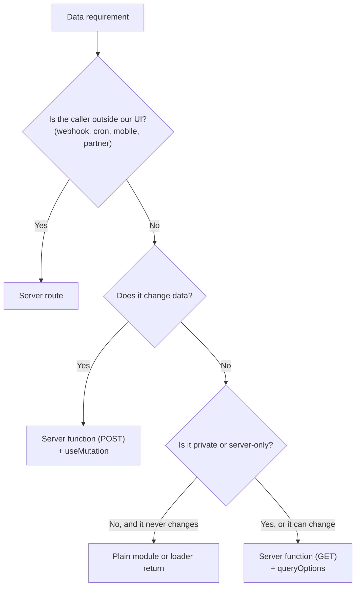

# Data Fetching

**When to read:** when designing how a feature reads and changes data, and before choosing between a server function, a server route, or a loader. This page chooses the strategy. Exact rules live in `docs/04-stack/tanstack-query.md`, `docs/04-stack/tanstack-router.md`, and `docs/03-standards/api-conventions.md`.

"Observed" below means run on a built app in a real browser on 2026-10-31 (Start 1.169.4, Router 1.170.46, Query 5.105.0; ADR 0014).

## Decide



**There is one path for our own UI:** server function, then `queryOptions`, then a loader and `useSuspenseQuery`. A page that is only read and a table that refetches use the same path. Only how the data loads changes.

## Reads: how the data loads

| Need | Loader | Component |
|---|---|---|
| In the first HTML: main content, SEO | `queryClient.query({ ...options, staleTime: 'static' })`, returned | `useSuspenseQuery(options)` |
| Slow and secondary: can arrive after the page | `void queryClient.query(options).catch(noop)`, not returned | `useSuspenseQuery(options)` inside its own `<Suspense>` |
| Several queries for one page | `Promise.all` of the above | One `useSuspenseQuery` each |
| Depends on browser state: a dialog, a selected row | None | `useQuery(options)` with `enabled` |
| Filter, sort, search, page | `loaderDeps` from validated search params | `useSuspenseQuery(options(search))` |
| Infinite scroll | `queryClient.infiniteQuery({ ...options, staleTime: 'static' })` | `useSuspenseInfiniteQuery(options)` |
| Auto-refresh | As the first row | `useSuspenseQuery({ ...options, refetchInterval })` |
| Route-only data, not shared and not refetched | Return the server function's result | `Route.useLoaderData()` |

### What was observed

| Check | Result |
|---|---|
| Blocking loader | The data is in the first HTML, and no server function runs after hydration while `staleTime` holds (30 s) |
| Non-blocking loader with `<Suspense>` (timed on the built handler; it also rendered in the browser) | Browser user agent: page at 87 ms, data at 882 ms in the same response. Googlebot user agent: nothing until 806 ms, then the complete page, so **streaming does not hide content from that crawler** |
| Three `useQueries` calling server functions | All three requests started within 1 ms: **server functions run in parallel** |
| Two `useSuspenseQuery` in one component, no loader | **Waterfall:** the second request starts 510 ms later, 1364 ms total. With `Promise.all` in the loader: same start, 855 ms |
| `Date` in a server function result | Still a `Date` after SSR hydration and after an RPC call |
| `refetchInterval` on `useSuspenseQuery` | Polls in the browser (4 calls in 1.3 s at 300 ms) |

## Lists with search and pagination

Search params are the state (`state-management.md`). Keep the keystrokes local, and write to the URL after a pause:

```tsx
// src/routes/invoices/index.tsx
export const Route = createFileRoute('/invoices/')({
  validateSearch: invoiceSearchSchema,
  loaderDeps: ({ search }) => search,
  loader: ({ context, deps }) =>
    context.queryClient.query({ ...invoiceListOptions(deps), staleTime: 'static' }),
  component: InvoicesPage,
})

// features/invoices/components/invoice-search.tsx
const [text, setText] = useState(search.q)
useEffect(() => {
  const timer = setTimeout(() => {
    if (text !== search.q) void navigate({ search: { q: text, page: 1 }, replace: true })
  }, 300)
  return () => clearTimeout(timer)
}, [text, search.q, navigate])
```

Observed with a 600 ms server: typing five characters sent one request, and the old rows stayed visible until the new ones arrived. The route's `pendingComponent` appears only when loading passes `defaultPendingMs` (1000 ms by default, from the installed types; the 1000 ms switch itself was not observed).

**`placeholderData` does not exist on the suspense hooks.** When a list is not driven by a loader (a picker in a dialog), use `useQuery` with `placeholderData: keepPreviousData` and dim the rows while `isPlaceholderData` is true (observed).

**A page past the end redirects to the last page.** A bookmarked `?page=9`, or the last row of a page deleted, leaves the URL on a page with no rows. The loader already has `total`, so it corrects the URL instead of showing an empty table:

```tsx
loader: async ({ context, deps }) => {
  const result = await context.queryClient.query({ ...invoiceListOptions(deps), staleTime: 'static' })
  if (!result.ok) return result
  const lastPage = Math.max(1, Math.ceil(result.data.total / result.data.pageSize))
  if (deps.page > lastPage) {
    throw redirect({ to: '/invoices', search: { ...deps, page: lastPage }, replace: true })
  }
  return result
},
```

**Not run.** `redirect` taking typed `to`, `search`, and `replace`, thrown from a loader, is **Verified** in the Router source and API docs (Context7 `/tanstack/router`, main branch, 2026-11-06), not against the installed 1.170.46 types. Cursor lists have no last page and need none of this.

**A picker gets its own query, never the paginated list's.** A select or combobox fed from page 1 of a list silently drops every option after it. Give the picker its own server function and `queryOptions` (`customerKeys.options(search)`) that return only what it shows, such as id and label, and stay bounded like any list: a search term and a `limit` (`api-conventions.md`, "Pagination"). Load it with `useQuery`, as above.

## Infinite lists

```ts
// features/invoices/queries.ts
export const invoiceFeedOptions = () =>
  infiniteQueryOptions({
    queryKey: invoiceKeys.feed(),
    initialPageParam: 0,
    queryFn: ({ pageParam }) => listInvoiceFeed({ data: { cursor: pageParam } }),
    getNextPageParam: (lastPage) => lastPage.nextCursor ?? undefined,
  })
```

Call `fetchNextPage` from a user action or when `hasNextPage && !isFetchingNextPage`. This shape ran with a numeric cursor; a composite cursor (`docs/04-stack/drizzle-postgres.md`) changes the type of `initialPageParam` and was not run through Query.

## Writes

`useMutation` with a `POST` server function. Who does what, step by step: `api-conventions.md`. Invalidate with `invalidateFeature`, only when `data.ok`; a query holding another feature's data declares `dependsOn` (`tanstack-query.md`, rule 12). Optimistic updates only when the action rarely fails: `tanstack-query.md`.

## When a server function throws `redirect()`

| Called from | Redirects? |
|---|---|
| A `queryFn` or `mutationFn` | **Yes**, through `setupRouterSsrQueryIntegration` (observed) |
| A loader or `beforeLoad` | **Inferred** yes (`tanstack-start.md`, rule 7); not run here |
| An event handler, wrapped in `useServerFn` | Yes (observed) |
| An event handler, called directly | **No:** the promise rejects with the redirect object and the page stays (observed) |

A plain call inside `queryOptions` is enough. Prefer `useMutation` over a bare call in an event handler. Use `useServerFn` only when something must call a server function outside Query.

## Decision matrix

| Requirement | Use | Detail |
|---|---|---|
| Page content, SEO | Blocking loader + `useSuspenseQuery` | `tanstack-query.md` |
| Form submit, create, update, delete, workflow step | Server function + `useMutation` | `api-conventions.md`, `tanstack-form.md` |
| Table with server pagination, sort, filter | Search params + `loaderDeps` + `manual*` table modes | `tanstack-table.md` |
| Infinite scroll, polling | Server function + Query | This page |
| Toggle that rarely fails | Optimistic `useMutation` | `tanstack-query.md` |
| Webhook, cron, mobile app, public API | Server route | `api-conventions.md` |
| File upload | Server route | `api-conventions.md` |
| Another feature's data | Its query options, or its service through `index.server.ts` | `cross-feature-communication.md` |

## Anti-patterns

| Do not | Why | Instead |
|---|---|---|
| Add a server route so our own UI can `fetch` it | Loses typed input and output, and needs its own CSRF middleware | Server function as `queryFn` |
| `useEffect` + `fetch`, or copying query data into `useState` | Goes stale, with no cache or retry | `useQuery`, and derive during render |
| Query the database in a loader | Loaders also run in the browser on navigation | Loader calls query options, which call a server function |
| Several `useSuspenseQuery` with no loader | Requests run one after another | Start them together in the loader |
| Different options in the loader and the component | The cache is not shared | One `queryOptions` factory |
| Put a secret or personal data in the input of a `GET` server function | The input is in the URL (`?payload=...`, observed), and URLs end up in logs and history | `POST` |
| Trust `beforeLoad` for protection | The function can be called directly | Auth middleware on the function (`security.md`) |
| Treat a server function call as success without reading `data.ok` | `ok: false` is a successful call to Query | Branch on `data.ok` (`error-handling.md`) |

## Checklist

- [ ] Is the caller our own UI? Then a server function, not a server route.
- [ ] Read or write? Does the `GET` input contain nothing sensitive?
- [ ] Must it be in the first HTML, or can it stream behind `<Suspense>`?
- [ ] Do the loader and component share one `queryOptions` factory?
- [ ] Does each query on the page start in the loader?
- [ ] Are filter, sort, and page in validated search params?
- [ ] Is `staleTime` deliberate? Is the list bounded (`api-conventions.md`, Pagination)?
- [ ] Does a page past the end redirect to the last page? Does each picker have its own bounded query?
- [ ] Does the code that reads a `Result` branch on `ok`?
